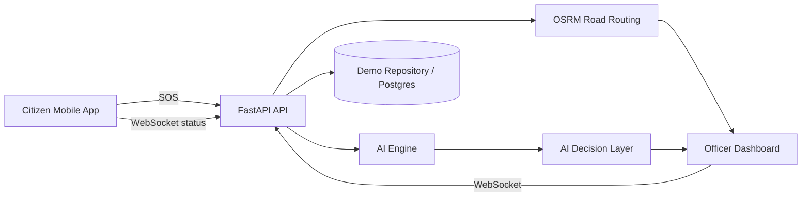

# ResQAI

## Intelligent Disaster Response and Emergency Decision Support Platform

ResQAI is a demo-ready emergency command platform that combines a Python FastAPI backend, explainable AI reasoning, a React command-center dashboard, and a Flutter citizen app. The project simulates a flood emergency from initial SOS creation through risk assessment, team assignment, live mapping, road blockage detection, dynamic replanning, and rescue resolution.

## Architecture overview



## Features

- Explainable flood emergency triage
- Forward chaining and backward chaining in the backend
- Demo Bayesian risk analysis with labeled probabilities
- Weighted A\* emergency route planning with blockage-aware replanning
- Real road routing through OpenStreetMap and OSRM
- SOS lifecycle APIs and dashboard actions
- Real-time WebSocket updates for dashboards and map refreshes
- Simulated live rescue tracking along returned OSRM geometry
- Route progress, current/next road, rescue instructions, follow-team controls, and incident timeline
- Team, shelter, hospital, and resource APIs
- Officer dashboard with overview, map, incident list, AI intelligence, and demo controls
- Citizen mobile flow for SOS creation and live rescue tracking
- Citizen SOS detail flow for emergency type, people affected, and medical assistance
- PostgreSQL/PostGIS schema with demo fallback repository

## Technology stack

- Backend: Python, FastAPI, Pydantic
- AI: Rule-based reasoning, simulated Bayesian inference, search algorithms
- Frontend: React, TypeScript, Vite, Leaflet, OpenStreetMap
- Road routing: OSRM driving profile with GeoJSON geometry and alternatives
- Mobile: Flutter, Dart
- Database: PostgreSQL/PostGIS with demo in-memory fallback

## Folder structure

- backend/app: API entrypoints and demo repository logic
- backend/tests: backend regression tests
- ai-engine: AI module wrappers and scenario logic
- officer-dashboard: command-center UI
- mobile: citizen emergency app
- database: schema and demo SQL definitions
- docs: architecture and demo presentation support

## Installation

### Backend

```bash
cd ResqAI
python3 -m venv .venv
.venv/bin/python -m pip install -r backend/requirements.txt
PYTHONPATH=backend .venv/bin/uvicorn app.main:app --reload --port 8000
```

### Dashboard

```bash
cd officer-dashboard
npm install
npm run dev
```

### Citizen app

````bash
cd mobile
flutter pub get
flutter run --dart-define=API_BASE_URL=http://10.0.2.2:8000```

For Android emulator use:

```bash
flutter run --dart-define=API_BASE_URL=http://10.0.2.2:8000
````

### PostGIS

```bash
docker compose up postgres
```

## Demo workflow

1. Start the FastAPI server.
2. Open the citizen app and tap the SOS button.
3. Select Flood, Fire, Medical, Accident, Building Collapse, or Other.
4. Set the number of people and choose whether medical assistance is required.
5. Press Confirm SOS. The existing `/api/sos` pipeline receives the selected values and retains the fixed demo location and environmental inputs.
6. Open the officer dashboard and review the AI decision: priority, risk probability, recommended team, shelter, hospital, and route.
7. Open an SOS detail page and press Start tracking.
8. Watch Team 04 move along the actual route with simulated GPS updates.
9. Trigger the road block simulation and observe dynamic replanning.
10. Press Mark rescue complete to retain the incident and release the team.

To verify real road routing, inspect `route.geometry.coordinates` in Swagger or the browser network response after creating a demo SOS. These `[longitude, latitude]` points come from OSRM and should bend along mapped streets. With the dashboard open, call `POST /api/simulation/road-block` to demonstrate the WebSocket blockage, replanning, and route update sequence without refreshing the page. The public OSRM route is the navigation ETA; the AI Weighted A\* value remains a decision cost and is not displayed as travel time.

## Core API endpoints

- POST /api/sos
- GET /api/sos
- GET /api/sos/{id}
- PATCH /api/sos/{id}
- DELETE /api/sos/{id}
- GET /api/dashboard
- GET /api/teams
- GET /api/teams/{id}
- PATCH /api/teams/{id}
- POST /api/teams/{id}/assign
- POST /api/teams/{id}/status
- GET /api/shelters
- GET /api/hospitals
- GET /api/ai/decision/{id}
- GET /api/routing/route?start_lat=12.9716&start_lon=77.5946&end_lat=12.9838&end_lon=77.5960
- GET /api/sos/{id}/tracking
- POST /api/sos/{id}/start
- POST /api/sos/{id}/complete
- POST /api/simulation/road-block
- WebSocket /ws

## WebSocket events

- sos_created
- sos_updated
- team_assigned
- team_status_changed
- route_updated
- route_calculated
- route_replanning
- ai_analysis_completed
- team_departed
- team_position_updated
- team_arrived
- road_blocked
- dashboard_update
- rescue_completed

## AI explanation

The backend intentionally exposes the reasoning path instead of hiding it behind a black box. The emergency risk and route decisions are generated using transparent demo logic:

- Forward chaining derives high_risk, critical_priority, ambulance_required, and hospital_required.
- Backward chaining traces goal-driven evidence such as hospital requirement.
- Bayesian risk model explains factors like rainfall, river proximity, flood reports, and uncertain roads.
- Weighted A\* route planning accounts for distance, time, flood risk, and blockage penalties.
- Dynamic replanning adjusts when a road is blocked.

## Real road routing

The AI and geographic routing layers are intentionally separate. The AI layer uses forward chaining, Bayesian-style risk analysis, and Weighted A\* to explain emergency priority, resource selection, and route preference. OpenStreetMap supplies the road network used by OSRM; OSRM calculates driving geometry, distance, duration, steps, and available alternatives; Leaflet renders the returned GeoJSON; and WebSockets update the dashboard without a refresh.

The public OSRM demo server is suitable for reasonable development and non-commercial demonstrations, but it is not a guaranteed production dependency. If it is unavailable, the API returns an explicitly labelled `Demo Fallback` route and the SOS flow continues. Production should self-host OSRM, use GraphHopper, or use a managed provider such as Mapbox or Google. The public OSRM service does not know ResQAI's custom flood or blockage data, so simulated hazard intelligence remains in the AI layer and replanning requests fresh road geometry honestly.

## Live rescue tracking

Tracking is deliberately local and simulated. The backend creates a FastAPI-compatible async task for each SOS, walks through the current OSRM LineString at a bounded interval, calculates distance travelled and remaining, extracts current and next OSRM step names, and emits `TEAM_POSITION_UPDATED`. The dashboard interpolates between those points so the Team 04 marker moves along the road geometry. The UI labels this as simulated GPS and never claims physical vehicle tracking.

All realtime envelopes include `type`, `timestamp`, `sos_id`, and `data`. The dashboard merges route, position, status, and timeline changes by `sos_id`, so one active incident cannot overwrite another incident's route.

## Testing

```bash
cd ResqAI
PYTHONPATH=backend .venv/bin/python -m pytest backend/tests -q
cd officer-dashboard && npm run build
cd mobile && flutter analyze
```

## Future enhancements

- Replace demo repository with SQLAlchemy/Postgres-backed persistence
- Add authentication and RBAC for officers and citizens
- Integrate with real mapping, weather, and hospital systems
- Add stronger multi-agent simulation and more realistic resource constraints
- Expand route graph and dynamic road updates
